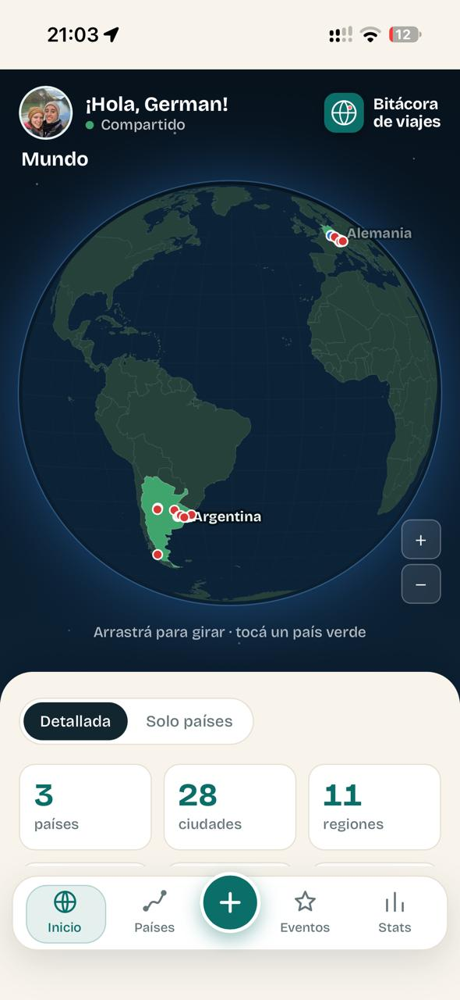
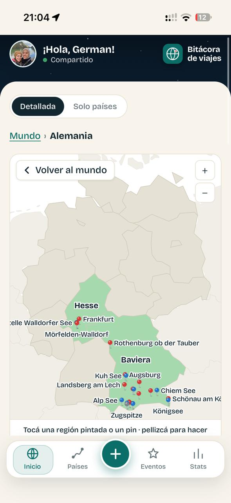
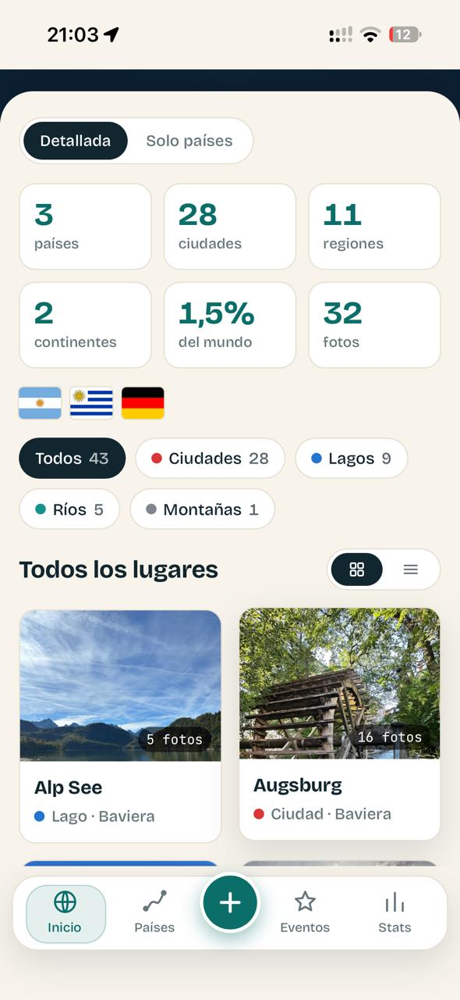
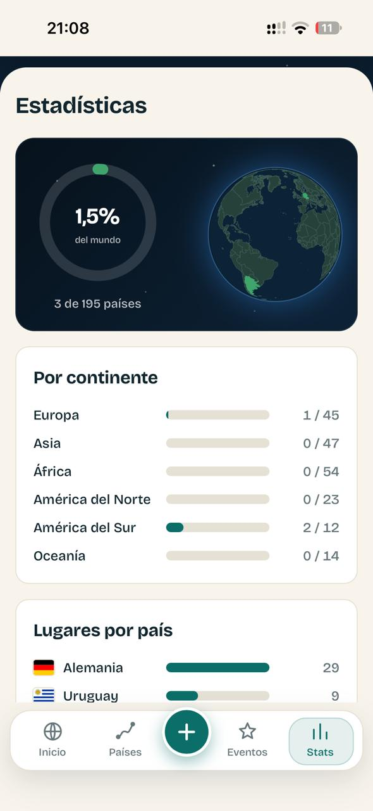
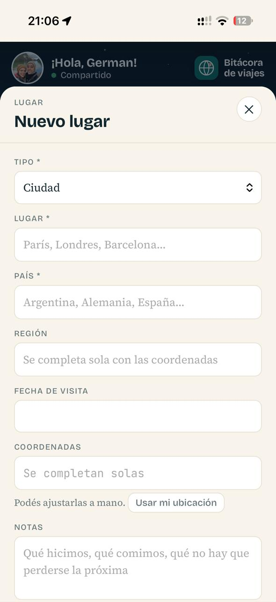

# Bitácora de viajes (Travel Log)

An installable web app (PWA) to keep a record of the places you have visited and the events you have been to, with photos. Everything is shown on a 3D globe and an interactive map, trips are built automatically from the dates you enter, and the app calculates statistics for countries, regions and continents visited.

**Live demo: https://mentoriaittude-bitacoradeviajes.mepzhl.easypanel.host**

<p>
  
  
  
  
</p>

## The problem

Travel memories end up scattered across spreadsheets, loose photos and the phone gallery. The app puts them in one place, organised and easy to come back to.

## Who it is for

Travellers, mountaineers and trekkers who want their trips in order and an easy way to revisit them. Couples or groups who travel together can share a profile.

## Features

- **Accounts:** sign up, log in and password recovery by email.
- **Individual and shared profiles,** with invitations.
- **Place search with autocomplete** (Google Places API), which also fills in region and coordinates.
- **3D globe,** a map per country and region, and a route map for each trip.
- **Photos compressed on the phone** before uploading.
- **Travel statistics:** countries, cities, regions and continents visited, and the percentage of the world covered.
- **Installable on the phone** (PWA with offline-capable service worker).

<p>
  
</p>

## Tech stack

Python · FastAPI · SQLite · JavaScript (no framework) · D3 · Google Places API · Docker · Easypanel

## Design decisions

- **Photos are resized in the browser.** Each photo is reduced to 2000 px and re-encoded as JPEG at 85% before upload, so a 6 MB phone photo becomes about 400 KB. This saves mobile data and server disk.
- **The Places API is rate-limited per user** (120 requests per minute and 2,000 per day), so one account cannot run up the Google bill.
- **Authentication basics:** passwords are hashed with salted PBKDF2-SHA256, and the session cookie is `HttpOnly`, `SameSite=Lax` and `Secure` behind HTTPS.
- **Simple storage on purpose.** SQLite on a persistent disk is enough for a single-instance app and keeps deployment trivial.
- **No frontend framework.** Plain JavaScript modules plus D3 keep the app small and fast to load on a phone.

## How it was built

Developed with Claude Code, following the WAT framework (Workflows, Agents, Tools) and design skills for the interface. Secrets live in `.env` and are never committed.

## Run locally

```bash
python3 -m venv .venv && .venv/bin/pip install -r requirements.txt
cp .env.example .env
.venv/bin/uvicorn tools.server:app --port 8000
```

Open http://localhost:8000. Without `SMTP_HOST`, emails are written to `data_local/outbox/` and printed to the console. Place search needs a `GOOGLE_MAPS_API_KEY` in `.env`.

## Project structure

```
tools/      FastAPI server, auth, database, Google Places client and utility scripts
web/        frontend (HTML, CSS, JS modules, service worker, manifest)
docs/       screenshots
Dockerfile  production image
```

## Deploy

Build with the `Dockerfile` on any container host (it is deployed on Easypanel). The container listens on `$PORT` (default 8000) and trusts the proxy's `X-Forwarded-*` headers. Set the variables from `.env.example` (`APP_URL`, `COOKIE_SECURE=1` behind HTTPS, SMTP settings, `GOOGLE_MAPS_API_KEY`) and mount a persistent disk at `DATA_DIR` for the database and photos.
